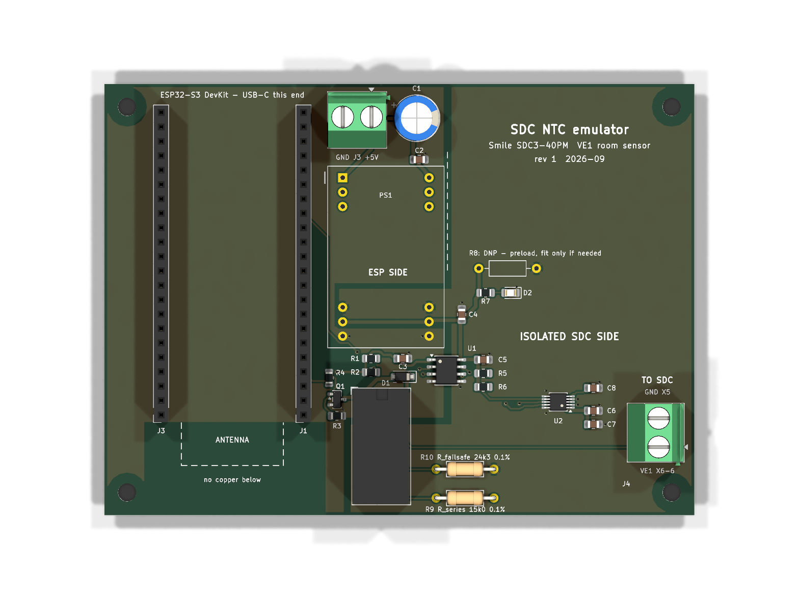

# SDC NTC emulator PCB (rev 1)

KiCad 9 project for the wireless room sensor of the Smile SDC3-40PM, as described in
[HANDOFF_SDC_NTC_Emulator.md](../../HANDOFF_SDC_NTC_Emulator.md): ESP32-S3 DevKit on sockets,
ISO1540 I2C isolator, Traco TEM 2-0511 isolated supply, AD5272 digital rheostat and the
Omron G5V-2 fail-safe relay. 2 layers, 104 × 76 mm, 4 × M3 holes.



## Status

| Check | Result |
|---|---|
| ERC | 0 errors, 0 warnings |
| DRC (incl. schematic parity) | 0 violations, 0 unconnected pads |
| Gerbers + drill for JLCPCB | `production/sdc-ntc-emulator-jlcpcb-gerbers.zip` |
| BOM | `production/sdc-ntc-emulator-bom.csv` |

## Verify before ordering

1. **DevKit row spacing: measured and set to 25.1 mm** (`DEVKIT_ROWS` in `tools/make_pcb.py`). Outer edges 25.6 mm, inner edges 24.6 mm, so the centre distance is 25.1 mm. This is not on the 0.1" grid.
   - The pinout is confirmed from the photo: it is identical to the official DevKitC-1.
   - Solder the sockets with the DevKit plugged in, so they align to the real pins.
   - The clone is ~56.6 × 27.7 mm, and its module antenna overhangs the DevKit edge by ~7 mm at the pin-1 end. The no-copper area covers that.
   - J3 pin 1 (GND) is intentionally not connected.
2. **TEM 2-0511 footprint** (`lib/sdc_emulator.pretty`, self-made). It follows the datasheet: DIP-24 grid, 15.24 mm rows, only pins 1-3, 10-15 and 22-24. Print 1:1 and hold the module against it.
3. **Terminal blocks.** The wire entries should face the board edge: J3 (5 V in) the top edge, J4 (to SDC) the right edge. This follows from KiCad's footprint graphics; confirm in the 3D view.
4. **R10 (R_failsafe) = 24.3 kΩ** assumes an SDC day setpoint of 21 °C. For another setpoint, pick the value from the NTC table in the handoff. R10 is a through-hole part, so it is easy to swap.

## Ordering at JLCPCB (bare board, hand soldering)

Upload the zip. Defaults are fine: 2 layers, 1.6 mm FR-4, 1 oz copper, HASL or ENIG, any colour.

- Smallest features: 0.13 mm clearance (only at the AD5272 MSOP-10 fan-out), 0.25 mm tracks, 0.8/0.4 mm vias. All are within JLC's standard capabilities.
- No assembly service needed.

## Assembly

Order: SMD first (U2 MSOP-10 first, with flux and a fine tip, then U1, Q1, D1, 0805 parts), then the low THT parts (R9, R10), then the sockets, relay, TEM, C1 and the terminals.

- **R8 is DNP.** Fit it (≈ 270 Ω, 0.6 W) only if the TEM output measures > 5.4 V without load.
- **D2** lights when the isolated side has power.
- Relay K1: both poles are wired in parallel on purpose. Two gold contacts are more reliable at µA currents.
- Before the first power-up, check with an ohmmeter: J4 VE1 to J4 GND = R10 (24.3 kΩ) with the relay off. There must be no connection at all between the ESP side GND (J3 −) and the SDC side GND (J4 GND).

Not on the PCB: the ESP32-S3 DevKit, the RAC03 with its fuse and mains terminals (separate section of the enclosure), 4 × M3 spacers.

## How the files are made

Everything is generated from `tools/design.py` (parts, values, footprints, nets) by:

```
python tools/build.py        # footprints -> schematic -> ERC -> netlist -> PCB -> DRC -> Gerbers/BOM/renders
```

- `tools/make_schematic.py`: writes `sdc-ntc-emulator.kicad_sch` from `design.py` (net labels at every pin).
- `tools/make_pcb.py` (runs in KiCad's Python): placement, routing, pours, keep-outs and silkscreen.
  - The router is a small grid A* router. It keeps each net inside its own domain (ESP side or isolated SDC side), so no copper can cross the isolation gap. The two ground pours are separate polygons with ≥ 1 mm gap.
  - Placement lives in `PLACEMENT`, domain outlines in `ESP_POLY`/`ISO_POLY`.
- `tools/make_footprints.py`: the TEM 2 footprint.

**Rebuilding overwrites the `.kicad_sch` and `.kicad_pcb`.** Make changes in `design.py`/`make_pcb.py` and rebuild. If you prefer to continue by hand in KiCad, stop using the scripts from that point on.

Known limitation: `kicad-cli` ignores `sdc-ntc-emulator.kicad_dru`. That is why the global minimum clearance is set to 0.13 mm (needed for the MSOP-10 pad gaps). The router itself keeps ≥ 0.3 mm everywhere else.
