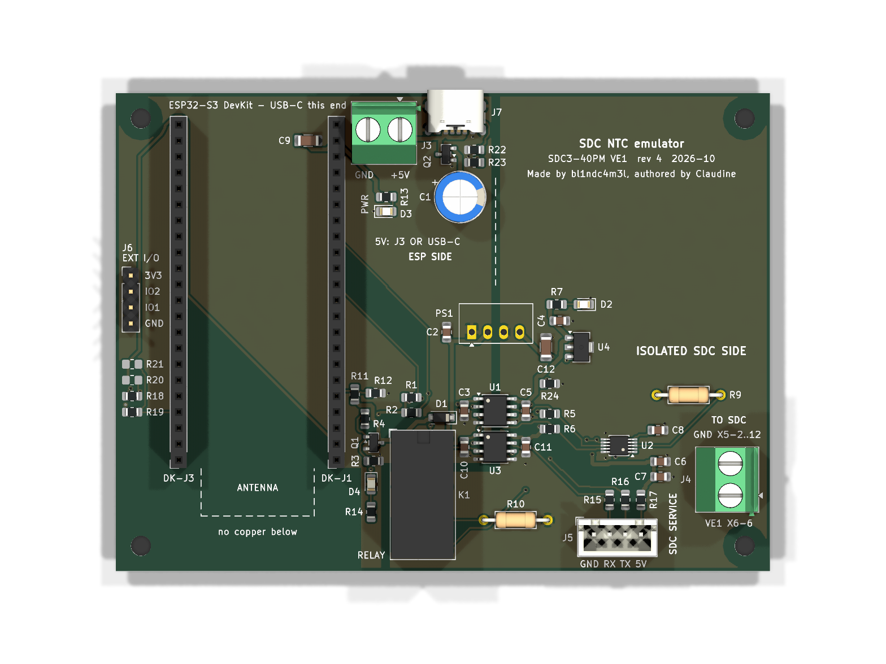

# SDC NTC emulator PCB (rev 4)

KiCad 9 project for the wireless room sensor of the Smile SDC3-40PM, as described in
[docs/design-notes.md](../docs/design-notes.md). On the board:
- ESP32-S3 DevKit on sockets
- ISO1540 I2C isolator, Gaptec 1S4E_0509S1U isolated 9 V supply + L78L05, AD5272 digital rheostat
- Omron G5V-2 fail-safe relay with state sense
- reverse-polarity protection on the 5 V input
- isolated UART to the SDC service port
- power and relay LEDs, and an expansion header

2 layers, 104 × 76 mm, 4 × M3 holes.



## Status

| Check | Result |
|---|---|
| ERC | 0 errors, 0 warnings |
| DRC (incl. schematic parity) | 0 violations, 0 unconnected pads |
| Isolation gap ESP ↔ SDC side (`tools/check_isolation.py`) | **≥ 1.14 mm** copper to copper, both layers (required ≥ 1.0 mm); tightest spot between PS1 pins 2 and 3 |
| Gerbers + drill for JLCPCB | `production/sdc-ntc-emulator-jlcpcb-gerbers.zip` |
| BOM | `production/sdc-ntc-emulator-bom.csv` |
| Order files for 3 boards (`BOARDS` in `tools/design.py`) | DigiKey BOM Manager: `production/sdc-ntc-emulator-digikey-order-3x.csv` (with DigiKey part numbers), Mouser BOM Tool: `production/sdc-ntc-emulator-mouser-order-3x.csv` |

Rev 3 (Traco TMR 1-0511, never ordered) is tagged `pcb-rev3` in git.

### Changes from rev 3 (2026-10-04): cheaper isolated supply

PS1 cost €8.85 per board (TMR 1-0511, a third of the DigiKey order). Rev 4 replaces it with an unregulated 5 V → 9 V module and a linear regulator, ≈ €2.75 per board in total.

- **PS1 Gaptec 1S4E_0509S1U** (Gaptec 1S4E_1U datasheet, DigiKey 3182-1S4E_0509S1U-ND):
  - 5 V in, 9 V / 111 mA out, unregulated, 1000 VDC, 20 pF isolation capacitance.
  - SIP-4 (1 GND, 2 Vin, 3 −Vo, 4 +Vo), pin-compatible with the Traco TME 05xxS, so it uses KiCad's TME symbol and footprint.
  - No-load input current max 15 mA (TMR: 40 mA).
  - **Needs ≥ 10 % load (11 mA)** (datasheet section 3; the selection table says 0 mA, the text wins). Below that the output voltage is not specified.
- **U4 L78L05ACUTR** (SOT-89) makes VDD_ISO = 5 V from the 9 V rail.
  - 30 V max input, so the unregulated rail's light-load rise (max +10 % at 10 % load, plus input tolerance: ≈ 10.5 V worst case) is harmless.
  - ≈ 1.7 V dropout; the rail stays above ≈ 8.4 V at our load.
  - Its ≈ 4–6 mA quiescent current counts towards the PS1 minimum load.
- **R24 1.5 kΩ** preload on the 9 V rail (≈ 6–7 mA, ≤ 75 mW). With U4's own current and the VDD_ISO load (U1/U3 side 2, D2, pull-ups) the module sees ≈ 15–20 mA, above its 10 % minimum.
- **C12 10 µF 25 V X7R 1206** (same part as C9) at the module output / LDO input. 25 V/1206 because a 16 V 0805 loses most of its capacitance at 10 V DC bias.
- **Isolation gap 1.40 → 1.14 mm.** On the SIP-4, +Vin (pin 2) and −Vout (pin 3) are 2.54 mm apart. The pads are narrow ovals (1.4 × 2.2 mm, 1.0 mm drill), and the gap line runs midway between pins 2 and 3.
- **Supply budget:** ≈ 40–45 mA from the 5 V rail for the isolated side (TMR: ≈ 50 mA). Estimated, not measured.
- **Clear zone around PS1:** C2 sits left of the module, C12/C4/U4/R24/R7/D2 right of it. No part lies where either possible body orientation could cover it.
- **Silkscreen:** every part's reference is printed next to it, never under a part body, and clear of pads, vias and other text. The labels are placed by `place_refs()` in `tools/make_pcb.py`, and the build fails if one finds no spot. Value texts are not printed; R9/R10's descriptions are gone, and their values are in the BOM.
  - J6 moved up into the free strip at the left edge. Its signal names (3V3, IO2, IO1, GND) sit next to each pin, and R18–R21 have room for their labels.
  - R22/R23 lie flat and stacked next to J7; the dashed gap line now starts below them.
  - Third title line: "Made by bl1ndc4m3l, authored by Claudine".

### Changes from rev 2 (2026-09-30 / 2026-10-01)

- **Isolated supply: Traco TMR 1-0511 replaces the TEM 2-0511** (PS1; Traco TMR 1 datasheet).
  - **Straight gap:** SIP-6 with the input at one end (pin 1 −Vin, pin 2 +Vin) and the output at the other (pin 4 +Vout, pin 6 −Vout). Pin 3 is absent, so there are 3.6 mm of copper between pins 2 and 4. The isolation gap is now one straight line from the top edge through PS1, U1 and U3, plus one step around the relay contacts. The TEM's pinout put −Vin next to +Vout and forced a notch into the gap.
  - **Wider gap:** 1.15 → 1.40 mm.
  - **Regulated** ±1 %, **no minimum load**, so the R8 preload resistor is gone.
  - **No-load input current** 40 mA instead of 80 mA, which relieves the tight RAC03 budget.
  - **1500 VDC** isolation, 200 mA output (the SDC side needs ≈ 10–20 mA).
  - **Footprint and outline:** KiCad's `Converter_DCDC_TRACO_TMR-1-xxxx_Single_THT`; body 17 × 7.6 mm instead of 32 × 20 mm.
  - **No tracks under the body:** Traco says to avoid traces under the converter, so the router keeps tracks and vias out from under the body beyond the pin row.
- **C2** (input decoupling) 100 nF → 10 µF, against the 80 mA p-p reflected input ripple.
- **USB-C power input J7** (GCT USB4125-GF-A-0190, power only):
  - It sits in parallel with J3, in front of Q2.
  - 5.1 kΩ on each CC line, so any USB-C charger supplies 5 V. There is no USB Power Delivery, so never more.
  - J3 shifted 1.9 mm left; Q2 and C1 moved down to make room.
- **SDC service port J5** (JST XH, 4-pin, bottom edge):

  | J5 pin | Signal | Notes |
  |---|---|---|
  | 1 | GND_ISO | |
  | 2 | RX | into the board; connect to the SDC's TX |
  | 3 | TX | out of the board; connect to the SDC's RX |
  | 4 | 5 V | VDD_ISO (since rev 4 from U4), through R17 |

  - **Isolated:** the 9600 baud UART goes through U3 (ISO7721). It sits across the gap like U1, so the port is on the SDC side of the barrier.
  - **ESP pins:** GPIO6 = RX, GPIO7 = TX.
  - **R15/R16 (1 kΩ):** protect the lines if the pinout turns out wrong, for example two outputs driving against each other.
  - **Idle state:** U3's outputs default high (UART idle) when its input is open, for example while the ESP boots or with no cable connected.
  - **The SDC socket's pinout is not measured yet**, see "Service port" below.
- **Power LED D3** (green) on +5 V after Q2, so it also shows that the input polarity is right.
- **Relay LED D4** (yellow): across the coil, not driven by a GPIO, so it shows whether the coil really has power.
- **Expansion header J6** (2.54 mm, left edge): 3V3, GPIO2, GPIO1, GND.
  - 100 Ω series resistors R18/R19.
  - Optional 4.7 kΩ pull-ups R20/R21 (DNP) for I2C or 1-Wire.
  - GPIO1/2 are ADC1-capable and have no strapping function.
- Extra 5 V load: ≈ 3 mA for the LEDs, plus U3 and whatever is plugged into J5 (fed via PS1). This is negligible against the Wi-Fi peaks.

### Changes from rev 1 (independent review, 2026-09-30)

- **Isolation gap** 0.40 mm → 1.15 mm. Rev 1's documentation wrongly claimed ≥ 1 mm. Fixes:
  - oval TEM pads, 1.24 mm between +Vout and −Vin
  - ≥ 1.2 mm between the domain outlines
  - the router keeps whole tracks inside their domain
  - a new build check measures the real gap
- **Relay state sense** R11/R12 → GPIO5 (LOW = coil energised).
- **Reverse-polarity P-FET** Q2 in the 5 V input.
- **Resistors:**
  - R9 (R_series) 15.0 → 18.2 kΩ: floor ≈ 27 °C even with the AD5272 unpowered or shorted.
  - R10 (R_failsafe) 24.3 → 24.9 kΩ, which accounts for the SDC's +0.5 K offset.
  - R1/R2 4.7 → 2.7 kΩ: ISO1540 side-1 sink current.
- **Layout and footprints:**
  - C3/C5 moved next to the ISO1540 supply pins.
  - Relay holes 1.0 mm, as Omron recommends.
  - The AD5272 fan-out now has no wide tracks, no vias and no signal tracks under the body. A and VSS are tied to GND by a short trace under the body, under solder mask.
  - Silkscreen text ≥ 1.0 mm.
  - "GND X5-2..12" marking, because X5-1 is the SDC data bus.

## Verify before ordering

1. **DevKit row spacing: 25.1 mm** (`DEVKIT_ROWS` in `tools/make_pcb.py`, measured: outer 25.6 / inner 24.6 mm).
   - The pinout is confirmed from a photo: it is identical to the official DevKitC-1.
   - Solder the sockets with the DevKit plugged in.
   - The clone is ~56.6 × 27.7 mm. Its module antenna overhangs the DevKit edge by ~7 mm at the pin-1 end; the no-copper area covers that.
   - DevKit J3 pin 1 (GND) is intentionally not connected.
   - On the silkscreen the DevKit headers are "DK-J1"/"DK-J3", to tell them apart from the 5 V terminal J3.
2. **PS1 footprint.** It is KiCad's Traco TME SIP-4 footprint with narrow oval pads (pins 1–4 on a 2.54 mm grid, 1.0 mm holes, as in the Gaptec drawing). The pin-1 marking (square pad, left) must be the GND (−Vin) end.
   - **Body side does not matter:** the pin row sits ≈ 1–1.7 mm from one face of the 6 mm deep body. No other part is placed within 5.6 mm of the pin row on either side, or within 6.3 mm of its centre along the row (`PS1_BODY_MAX` in `tools/make_pcb.py`, checked by the build). So the module fits whichever way its body extends.
   - **After assembly, measure** the 9 V rail at C12 (expect ≈ 9–10.5 V) and VDD_ISO at C4 (5 V ±4 %).
3. **Terminal blocks.** The wire entries should face the board edge: J3 (5 V in) the top edge, J4 (to SDC) the right edge. This follows from KiCad's footprint graphics; confirm in the 3D view.
4. **R10 (R_failsafe) = 24.9 kΩ** assumes an SDC day setpoint of 21 °C (displayed). For another setpoint, pick the value from the NTC table in the [design notes](../docs/design-notes.md#ntc-20-resistance-from-service-manual-en2h-0221ge51-r1020-ch-821), taking the +0.5 K display offset into account. It is a through-hole part, so it is easy to swap.

## Ordering at JLCPCB (bare board, hand soldering)

Upload the zip. Defaults are fine: 2 layers, 1.6 mm FR-4, 1 oz copper, HASL or ENIG, any colour. No assembly service needed.

Smallest features, all within JLC's standard capabilities:
- **Clearance:** ≥ 0.20 mm everywhere except at the AD5272 MSOP-10 (rule there: 0.13 mm; actual: 0.15 mm pad gap, and one via 0.175 mm from a track at its courtyard edge). Verified by a DRC run with 0.20 mm netclass clearance.
- **Tracks:** 0.25 mm.
- **Vias:** 0.8/0.4 mm, tented.

## Assembly

Order:
1. SMD first:
   - U2 (MSOP-10) first, with flux and a fine tip;
   - then U1, U3, Q1, Q2, D1 and the 0805/1206 parts;
   - C9 sits under the DevKit;
   - LEDs: the cathode mark faces GND (D3) or the relay coil (D4).
2. The low THT parts (R9, R10).
3. The sockets, relay, PS1, C1, the terminals, J5 and J6.

**USB-C J7** (GCT USB4125-GF-A-0190):
- Solder the 6 SMD contacts first, with flux. The two CC pads in the middle are only 0.3 mm apart.
- Then solder the 4 shell pegs from the bottom.
- The two 5.1 kΩ resistors right behind it (references not printed) are R22 (left, CC1) and R23 (right, CC2).

Left edge, next to J6 (references not printed), top to bottom:

| Position | Part | Value |
|---|---|---|
| 1 | R21 | 4.7 kΩ pull-up GPIO1, DNP |
| 2 | R20 | 4.7 kΩ pull-up GPIO2, DNP |
| 3 | R18 | 100 Ω, GPIO2 |
| 4 | R19 | 100 Ω, GPIO1 |

Notes:
- **D2** lights when the isolated side has power.
- Relay K1: both poles are wired in parallel on purpose. Two gold contacts are more reliable at µA currents.
- **Before the first power-up, check with an ohmmeter:**
  - J4 VE1 to J4 GND = R10 (24.9 kΩ) with the relay off.
  - There must be no connection at all between the ESP side GND (J3 −) and the SDC side GND (J4 GND).
- **Wiring to the SDC:** J4 GND to **X5-2…12, never X5-1** (T2B data bus).

Not on the PCB: the ESP32-S3 DevKit, the RAC03 with its fuse and mains terminals (separate section of the enclosure), 4 × M3 spacers.

## 5 V supply alternatives (RAC03 is end-of-life) and kit package

There are two 5 V inputs, wired in parallel in front of Q2:
- **J7, USB-C** (top edge, next to J3): any USB-C charger.
  - The board is a plain power sink, with 5.1 kΩ on each CC line (R22/R23). There is no USB Power Delivery negotiation, so a charger never supplies more than 5 V.
  - Use a charger rated **5 V ≥ 2 A**. A PC USB port (0.5–0.9 A) is too weak for the Wi-Fi peaks.
- **J3, screw terminal:** any regulated 5 V supply with wires. Q2 protects against swapped polarity, not against overvoltage.

**Use only one of J3 and J7.** Both feed the same node, so two supplies connected at the same time would drive each other. The DevKit's own USB ports are a third route; see the open diode check in the [design notes](../docs/design-notes.md#open-points). Powering the board from the DevKit's USB port instead is not recommended: the DevKit's VBUS diode drops ≈ 0.4 V, which leaves PS1 at the edge of its 4.5 V minimum.

| Option | Part | Rating | Mains wiring by the user | Notes |
|---|---|---|---|---|
| **Kit default** | any certified **USB-C charger** into J7 | 5 V ≥ 2 A | **none** | Every buyer has one. With a cable it reaches about 3–4× the RAC03's current, which ends the tight Wi-Fi peak budget. Needs a socket near the SDC. |
| Plug-in adapter with wires | Mean Well **SGA12E05-P1J** | 5 V / 2.4 A, 12 W, EU plug | **none** | CE/CB certified, 5.5/2.1 mm barrel plug, centre positive. Connect it into J3 with a DC-jack-to-screw-terminal pigtail, or cut the plug off. |
| Same concept as the RAC03 | Recom **RAC05-05SK/277/W** | 5 V / 1 A, 5 W, 80–305 VAC, wire leads | yes (qualified person) | Potted module with flying leads, so the PCB stays mains-free. Needs a slow-blow fuse and an enclosure with a separate mains section. |
| Control cabinet / DIN rail | Mean Well **HDR-15-5** | 5 V / 2.4 A, 12 W, 17.5 mm wide | yes (qualified person) | Screw terminals, < 0.3 W no-load. Fits next to other DIN-rail equipment in the boiler room. |

**Selling as a kit** (bare PCB + parts, unassembled):
- Included: PCB and all parts from the order file. Power comes from the buyer's own USB-C charger, so the buyer never touches mains.
- Not included: the ESP32-S3 DevKit (the buyer brings it, or offer it as an option) and the enclosure.
- Documentation: this README and the design notes, with the wiring to the SDC (X5-2…12, never X5-1) and the service-port pinout once it is measured.

## Bench checks after assembly

- **VDD_ISO** (C4, against J4 GND): 5.0 V ±1 % (4.95–5.05 V).
- **I2C on the ESP side:** look at SDA/SCL with a scope. The ISO1540's low level (≤ 0.8 V) is close to the ESP32-S3's VIL (0.825 V).
- **Relay sense:** GPIO5 must read HIGH with the relay off and LOW with it on. D4 must light exactly when GPIO5 is LOW.
- **USB-C input:** with a charger on J7, D3 lights and +5 V (C1) reads ≈ 5 V. With the board unpowered, CC1 and CC2 each measure 5.1 kΩ to GND.
- **Service port idle:** with nothing on J5, GPIO6 reads HIGH, and J5-3 (TX) measures ≈ 5 V against J5-1.

## Service port (J5): before connecting the SDC

The SDC has a 6-pin socket (≈ 1.0 mm pitch) behind the small flap above the day/night buttons. It carries a proprietary framed protocol at 9600 baud, 5 V logic:
- frames end with `21 0A 0A`;
- checksum CRC-16/KERMIT;
- a decoder from an earlier sniffing project exists.

**Its pinout is not known yet.** Measure before connecting anything:

1. With the SDC powered, measure every pin against **X5-2** (sensor GND):
   - GND reads 0 V;
   - a supply pin reads a steady ≈ 5 V;
   - the SDC's TX idles at ≈ 5 V and flickers on a scope or logic analyser;
   - the SDC's RX idles high, but stays quiet.
2. **With the SDC off, check continuity from the port's GND to X5-2.** J5-1 is GND_ISO, which is the same net as J4 GND (X5). Only connect J5-1 if the port GND and X5 are the same potential. If they are not, J5 would tie two different grounds together through the board. That needs a separate isolated domain for the port (a board change).
3. If the port has its own 5 V pin, **remove R17**. Otherwise PS1 and the SDC's supply would drive the same line. With R17 fitted, J5-4 is a 5 V supply for an adapter at the SDC end.
4. Wiring:
   - J5-2 (RX) to the SDC's **TX**;
   - J5-3 (TX) to the SDC's **RX**.
   - Start listen-only: leave J5-3 unconnected, or keep the ESPHome UART `tx_pin` unset, until the protocol is understood.
5. Mating plug: JST XHP-4. Keep the fragile 1.0 mm adapter at the SDC end: a 3D-printed insert that fills the flap recess, carrying a 1.0 mm pin header or pogo pins. Add strain relief to the housing.

## How the files are made

Everything is generated from `tools/design.py` (parts, values, footprints, nets) by:

```
python tools/build.py   # footprints -> schematic -> ERC -> netlist -> PCB -> DRC -> isolation check -> Gerbers/BOM/renders
```

Requirements:
- **KiCad 9.0** (the committed outputs were made with 9.0.7). `tools/make_pcb.py` and `tools/check_isolation.py` run in KiCad's own Python, which provides `pcbnew` and `numpy`.
- **Python 3** for `build.py`, `make_schematic.py` and `make_footprints.py` (standard library only).
- The scripts default to the Windows install in `C:\Program Files\KiCad\9.0`. Elsewhere, set:

  | Variable | Points to | Example (Linux) |
  |---|---|---|
  | `KICAD_CLI` | `kicad-cli` | `/usr/bin/kicad-cli` |
  | `KICAD_PYTHON` | a Python that can `import pcbnew` (needs `numpy`) | `python3` |
  | `KICAD9_SYMBOL_DIR` | KiCad's standard symbol libraries | `/usr/share/kicad/symbols` |
  | `KICAD9_FOOTPRINT_DIR` | KiCad's standard footprint libraries | `/usr/share/kicad/footprints` |

  On Windows with KiCad installed elsewhere, `KICAD_BIN` (the folder with `kicad-cli.exe` and `python.exe`) is enough for the first two.

- `tools/make_schematic.py`: writes `sdc-ntc-emulator.kicad_sch` from `design.py` (net labels at every pin).
- `tools/make_pcb.py` (runs in KiCad's Python): placement, routing, pours, keep-outs and silkscreen.
  - The router is a small grid A* router.
  - Each net is kept inside its own domain outline (ESP side or isolated SDC side), including half its track width.
  - The AD5272 fan-out is routed in a fixed order, with protected exit corridors for each 0.5 mm-pitch pin.
  - Placement lives in `PLACEMENT`, domain outlines in `ESP_POLY`/`ISO_POLY`.
- `tools/check_isolation.py` (KiCad Python): merges all copper of each domain per layer and measures the true minimum gap. The build fails below 1.0 mm.
- `tools/make_footprints.py`: the TEM 2 footprint (no longer used since PS1 is a TMR 1; kept with its symbol in `lib/` in case the TEM 2-0511 on hand is used for something else).

**Rebuilding overwrites the `.kicad_sch` and `.kicad_pcb`.** Make changes in `design.py`/`make_pcb.py` and rebuild. If you prefer to continue by hand in KiCad, stop using the scripts from that point on, and run `check_isolation.py` after your edits.

**Known limitation:** `kicad-cli` ignores `sdc-ntc-emulator.kicad_dru`; even a deliberately broken rule gives no error. That is why:
- the global minimum clearance is 0.13 mm, needed for the MSOP-10 pad gaps;
- the isolation gap is checked by `check_isolation.py` instead of a DRC rule.
